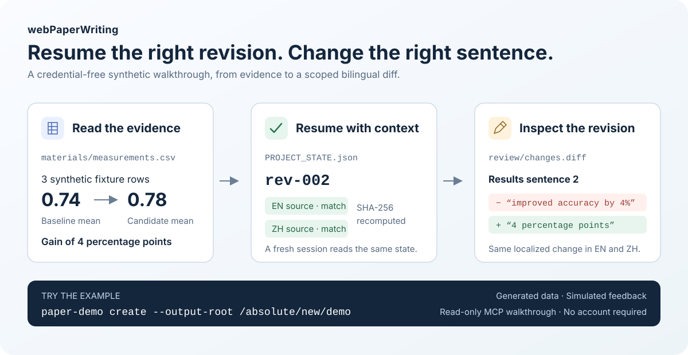
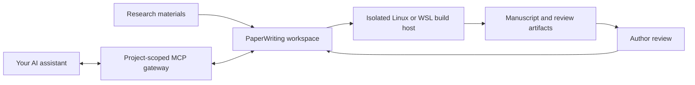

# webPaperWriting

Write research papers with AI that can find your evidence, revise the right version, and carry the work into your next conversation.

**V0.8.1** · [简体中文](README.zh-CN.md) · [Get started](docs/INSTALL.md) · [Give this to your AI](docs/AI_ONBOARDING.md) · [Platform status](docs/COMPATIBILITY.md)

webPaperWriting connects local research materials, an AI writing assistant, and traceable manuscript revisions. It combines a Python toolkit, a reusable **web论文写作** skill, and project-scoped MCP tools. Start with a synthetic paper on your computer, then connect your own research workspace through WebCodex.



## See a complete revision

The quickstart creates an original bilingual example with measurements, a writing brief, two manuscript revisions, simulated author feedback, and a source-linked continuation record. It works offline with Python 3.11+, without a cloud account or TeX installation.

Download the source archive from [V0.8.1](https://github.com/whulxc/webPaperWriting/releases/tag/V0.8.1) and open its extracted directory. Follow the platform-specific Python environment steps in the installation guide, then run these commands in that environment.

```text
python -m pip install .
paper-demo create --output-root /absolute/new/paper-demo
paper-demo inspect --project-root /absolute/new/paper-demo
```

Use a new absolute output directory. On Windows, use a path such as `C:\work\paper-demo`. Open `DEMO_REPORT.md` and `review/changes.diff` in the generated project. They show the evidence, the localized revision, and what a subsequent conversation should read. The example's author feedback is explicitly simulated. [Quickstart details](examples/quickstart/README.md)

To let an MCP-capable local assistant inspect the example, configure it to launch `paper-demo serve --project-root <absolute-demo-path>`. The demo exposes a small read-only synthetic tool set using the shared protocol and continuation reader. [AI setup and tool contracts](docs/AI_ONBOARDING.md)

## What you can do

- **Write from evidence.** Carry result tables, figure sources, references, and provenance into a dedicated `PaperWriting/` workspace.
- **Revise with a clear scope.** Preserve accepted text and handle bilingual sections, individual figures, or a full manuscript through the same project contract.
- **Resume from the right source.** Inspect registered versions and verify source hashes before continuing a manuscript.
- **Keep references inspectable.** Use project BibTeX and optional scoped Zotero access. Public literature metadata remains a candidate until verified against the source.
- **Build and review.** Connect an isolated Linux or WSL build host for TeX, figure generation, and PDF tools. Optional Drive delivery links review files to their build identities and comments.

## How it fits together



A local coding assistant prepares the research materials. The writing assistant reads the selected project's tools and sources, proposes revisions, and carries accepted changes into the next draft. The author controls acceptance and external publication. Google Drive and Zotero are optional integrations. The online project connection uses the separately installed WebCodex runtime. [Workflow](docs/WORKFLOW.md) · [WebCodex upstream](https://github.com/yyjeqhc/webcodex)

## Platforms and release evidence

The release provides Python installation, CLI, skill, and local MCP core paths for **Linux, WSL 2, Windows, and macOS**. Controlled TeX and figure workers use the Linux isolation backend. Windows and macOS users can attach a Linux build host. Windows users can also use WSL 2.

The release preparation covers source, packaging, and synthetic contracts. Physical-machine installation, real AI-client sessions, and native application integration have not been accepted across the four targets. The compatibility matrix records the exact scope. [Installation](docs/INSTALL.md) · [Compatibility and validation](docs/COMPATIBILITY.md)

## Choose your next step

| Goal | Guide |
| --- | --- |
| Try the offline example | [Quickstart](examples/quickstart/README.md) |
| Have an AI install or connect the tools | [AI onboarding](docs/AI_ONBOARDING.md) |
| Bring an existing paper | [User guide](USER_GUIDE.md) |
| Understand the writing and revision process | [Workflow](docs/WORKFLOW.md) |
| Inspect the MCP tool schemas | [Machine-readable tool catalog](integrations/mcp/tools.schema.json) |
| Change the implementation | [Contributing](CONTRIBUTING.md) |
| Report a security issue | [Security policy](SECURITY.md) |

## Release contents

The source distribution includes the Python implementation, public configuration templates, the shared writing skill, synthetic examples, and fixture tests. Release assets include the Python wheel, skill archive, and SHA-256 checksums. See the release's asset list for the files actually published. Software, skill, and manuscript version numbers are recorded separately. [Changes](CHANGELOG.md)

Original project code is distributed under [Apache-2.0](LICENSE). Bundled components retain the notices in [NOTICE](NOTICE). Paper materials, journal templates, fonts, reference PDFs, and external software are supplied under their own terms.
