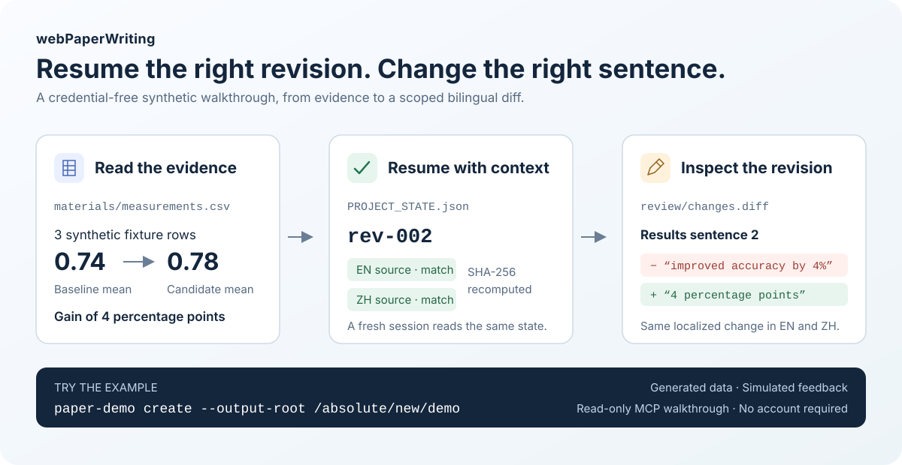
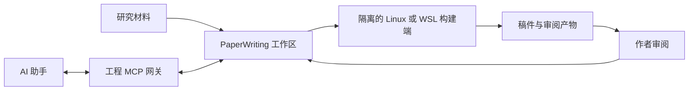

# webPaperWriting

让 AI 找到研究证据、修改正确的稿件，并把写作工作接续到下一次会话。

**V0.8.1** · [English](README.md) · [开始安装](docs/INSTALL.md) · [交给你的 AI](docs/AI_ONBOARDING.md) · [平台状态](docs/COMPATIBILITY.md)

webPaperWriting 将本地研究材料、AI 写作和可追溯的稿件修订连在一起，提供 Python 工具、共用的「web论文写作」技能及按工程授权的 MCP 工具。先在自己的电脑上运行合成论文示例，再通过 WebCodex 连接自己的科研工程。



## 先看一次完整修订

快速示例生成一份原创的中英文材料，包括测量数据、写作 Brief、两次稿件修订、模拟作者意见，以及绑定源文件的接续记录。Python 3.11+ 即可离线运行，体验过程无需云账号和 TeX。

从 [V0.8.1](https://github.com/whulxc/webPaperWriting/releases/tag/V0.8.1) 下载源码包并解压，按安装指南建立适合操作系统的 Python 环境，然后在源码根目录运行。

```text
python -m pip install .
paper-demo create --output-root /absolute/new/paper-demo
paper-demo inspect --project-root /absolute/new/paper-demo
```

输出位置使用全新绝对目录，Windows 可使用 `C:\work\paper-demo`。打开生成的 `DEMO_REPORT.md` 和 `review/changes.diff`，查看证据、局部修订，以及下一次会话应读取的内容。示例中的作者意见明确标为模拟。[快速示例说明](examples/quickstart/README.md)

支持本地 MCP 的 AI 可以启动 `paper-demo serve --project-root <绝对示例路径>`。它使用共享协议和接续读取逻辑，暴露一组只读的合成工具。[AI 接入及工具契约](docs/AI_ONBOARDING.md)

## 可以做什么

- **带着证据写作。** 将结果表、图源、参考文献和来源索引交入论文自己的 `PaperWriting/`。
- **按指定范围修订。** 沿用已接受的文字，处理双语章节、单幅图或全文重构。
- **从正确的版本接续。** 查到已登记稿件，核验源文件哈希后继续改稿。
- **核对参考文献。** 使用项目 BibTeX 和按需启用的 Zotero。公开文献元数据保留为待核候选，具体论断通过原文核实。
- **构建和审阅。** 连接隔离的 Linux 或 WSL 构建端，生成 TeX、图件和 PDF。按需启用 Drive，将审阅文件、构建身份和批注关联。

## 工作方式



本地编程助手准备材料，写作助手读取所选工程的工具和来源，提出修订，并将已接受的修改带入下一稿。作者决定采用哪些内容，以及何时对外交付。Google Drive 和 Zotero 按需配置。线上工程连接使用独立安装的 WebCodex。[完整工作流](docs/WORKFLOW.md) · [WebCodex 上游](https://github.com/yyjeqhc/webcodex)

## 平台与验证范围

本版面向 **Linux、WSL 2、Windows、macOS** 整理 Python 安装、CLI、技能和本地 MCP 核心路径。受控 TeX 和图件工作者使用 Linux 隔离后端。Windows、macOS 可连接 Linux 构建端，Windows 也可使用 WSL 2。

本轮发布准备覆盖源码、打包与合成契约检查。四个平台的真机安装、真实 AI 客户端会话及原生应用集成仍待各自验收。平台矩阵记录具体范围。[安装](docs/INSTALL.md) · [兼容与验证](docs/COMPATIBILITY.md)

## 接下来做什么

| 目标 | 入口 |
| --- | --- |
| 先运行离线示例 | [快速示例](examples/quickstart/README.md) |
| 让 AI 安装或连接 | [AI 接入](docs/AI_ONBOARDING.md) |
| 接入自己的论文 | [用户指南](USER_GUIDE.md) |
| 理解写作与返修 | [完整工作流](docs/WORKFLOW.md) |
| 查看 MCP 参数 | [机器可读工具清单](integrations/mcp/tools.schema.json) |
| 参与开发 | [贡献指南](CONTRIBUTING.md) |
| 反馈安全问题 | [安全政策](SECURITY.md) |

## 发行内容

源码包含 Python 实现、通用配置模板、共享写作技能、合成示例和相应测试。发行附件提供 Python wheel、技能包及 SHA-256 校验清单，实际附件以当前 Release 为准。软件版本、技能版本和论文稿号分别记录。[版本说明](CHANGELOG.md)

原创代码采用 [Apache-2.0](LICENSE)，内置组件沿用 [NOTICE](NOTICE) 中的声明。真实论文、期刊模板、字体、文献 PDF 和外部软件分别由使用者按其授权提供。
